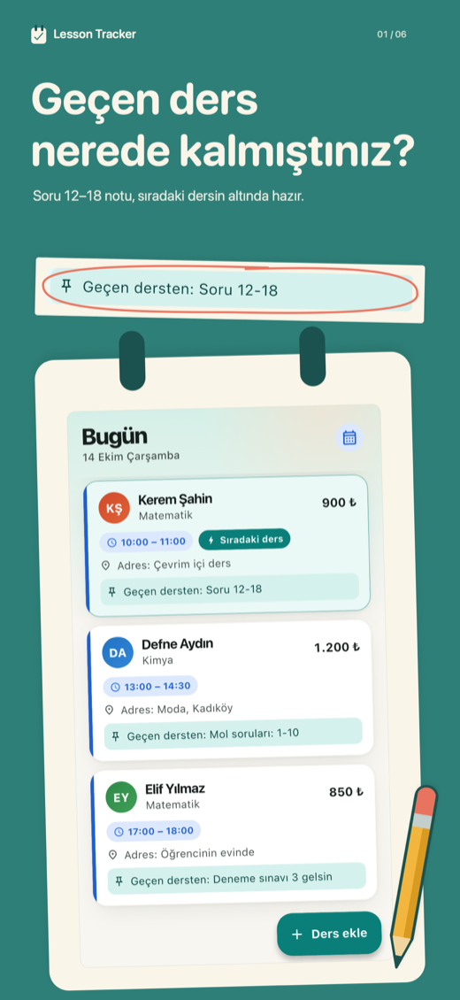

# Lesson Tracker

**Derslerin, öğrencilerin ve ödemelerin bir arada.**
*Your lessons, students and payments together.*

[Türkçe](#türkçe) · [English](#english)

---

## Türkçe

**Lesson Tracker**, özel ders veren öğretmenler için sade bir düzenleyici. App Store’daki adı “Lesson Tracker: Ders Ajandası”. Hesap yok, giriş yok, reklam yok. iPhone’da dikey kullanım için hazırlanmıştır.

### Özellikler

| Özellik | Kısaca |
|---|---|
| **Öğrenciler** | Öğrenci ve isteğe bağlı veli bilgileri, ders ücreti ve notlar |
| **Dersler** | Haftalık program, yapılan/iptal/telafi dersleri, konu ve notlar |
| **Ödemeler** | Alınan ve bekleyen ödemeler, ders bazında ödeme kaydı, istatistikler |
| **Hatırlatmalar** | Yerel ders ve ödeme bildirimleri |
| **Takvim** | İsteğe bağlı iOS Takvim eşitlemesi, ayrı “Lesson Tracker” takvimi |
| **Dosyalar** | Dosyayla yedekleme/geri yükleme, ders ve ödeme CSV dışa aktarma |

### Öne çıkanlar

- **İnternetsiz:** uygulama internete bağlanmaz, kayıtlar cihazında tutulur.
- **Veri toplamaz:** hesap, sunucu, analitik ve reklam yok.
- **Kontrol sende:** Takvim hesabı eşitlemesi ve dosya paylaşımı isteğe bağlıdır; kayıtlar seçtiğin hizmetlere gidebilir. Ayrıntılar gizlilik politikasında.
- **Para birimleri:** TRY, USD, EUR, GBP, CAD, AUD, CHF; kur dönüşümü yok.
- **Görünüm:** açık, koyu veya sistem teması.
- **Türkçe ve İngilizce** arayüz.
- **Ödeme kaydı:** tahsilat veya para transferi yapmaz; aldığın ödemeyi sen kaydedersin.

### Bağlantılar

| | |
|---|---|
| Web sayfası | <https://hasanardaaydogan.github.io/lesson-tracker-app/> |
| Gizlilik Politikası | <https://hasanardaaydogan.github.io/lesson-tracker-app/privacy.html> |
| Destek | <https://hasanardaaydogan.github.io/lesson-tracker-app/support.html> |

### İletişim

Soru, geri bildirim ya da destek için: [ar-ay06@hotmail.com](mailto:ar-ay06@hotmail.com)

---

## English

**Lesson Tracker** is a simple organizer for private tutors. Its App Store name is “Lesson Tracker: Tutor Agenda”. No account, no sign-in, no ads. Built for portrait use on iPhone.

### Features

| Feature | In short |
|---|---|
| **Students** | Student and optional parent details, lesson fees and notes |
| **Lessons** | Weekly schedules, completed/cancelled/makeup lessons, topics and notes |
| **Payments** | Received and outstanding amounts, payments linked to lessons, statistics |
| **Reminders** | Local lesson and payment notifications |
| **Calendar** | Optional iOS Calendar sync, separate “Lesson Tracker” calendar |
| **Files** | File backup/restore, lesson and payment CSV export |

### Highlights

- **Offline:** the app makes no internet connections; records are kept on your device.
- **No data collected:** no account, server, analytics or ads.
- **Your choice:** Calendar account sync and file sharing are optional; records may go to services you choose. See the privacy policy for details.
- **Currencies:** TRY, USD, EUR, GBP, CAD, AUD, CHF; no exchange rate conversion.
- **Appearance:** light, dark or system theme.
- **Turkish and English** interface.
- **Payment records:** no payment processing or money transfers; you record payments you have received.

### Links

| | |
|---|---|
| Website | <https://hasanardaaydogan.github.io/lesson-tracker-app/> |
| Privacy Policy | <https://hasanardaaydogan.github.io/lesson-tracker-app/privacy.html> |
| Support | <https://hasanardaaydogan.github.io/lesson-tracker-app/support.html> |

### Contact

Questions, feedback or support: [ar-ay06@hotmail.com](mailto:ar-ay06@hotmail.com)

---

## Yayınlama / Publishing

1. GitHub’da ayrı, herkese açık `hasanardaaydogan/lesson-tracker-app` deposunu oluştur. Bu klasördeki dosyaları deponun köküne kopyala; uygulama kaynaklarını kopyalama. / Create the separate public repository and copy this folder's contents to its root; do not copy app source code.
2. `ekran-goruntusu.png` (TR) ve `ekran-goruntusu-en.png` (EN), `store/ios/pazarlama/iphone-6.3/{tr,en}/01-bugun.png` görsellerinin 520 px genişliğe küçültülmüş hâlleridir; site köküne birlikte kopyalanır. / The two screenshots are 520 px wide downscaled copies of the store images `01-bugun.png` (tr/en); copy them to the site root with the pages.
3. Dosyaları `main` dalına yükle. Settings → Pages → Deploy from a branch → `main` → `/ (root)` → Save. / Upload the files to `main` and enable Pages from the branch root.
4. Yukarıdaki üç URL’yi oturum açmadan kontrol et; iki dilde bağlantıları, e-postayı ve ekran görüntüsünü aç. App Store Connect’e bu URL’leri gir. / Open all three URLs signed out, check both languages, links, email and screenshot, then enter the URLs in App Store Connect.

Depo oluşturma, push ve Pages yayını bu görevde yapılmadı; URL’ler yayın sonrası kullanılacak adreslerdir. / Repository creation, push and Pages deployment were not performed; these are the intended published URLs.

---

© 2026 Hasan Arda Aydoğan

